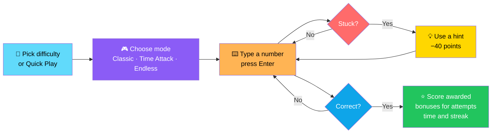
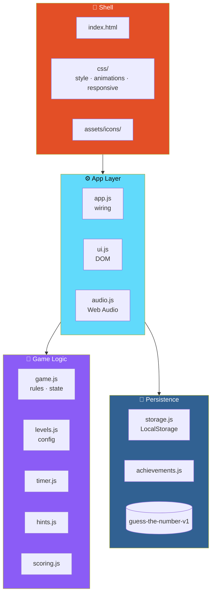

# 🎯 GUESS THE NUMBER

<div align="center">


**A complete browser game in vanilla HTML/CSS/JS.**

*5 difficulties · 3 modes · 4 hints · 7 achievements · Daily rewards · Zero backend*

[🚀 Run It](#-run-it) • [✨ Features](#-features) • [🎮 Rules & Controls](#-rules--controls) • [🏗️ Architecture](#️-architecture) • [🔧 Customize](#-customize)

</div>

---

## 📖 Overview

**GUESS THE NUMBER** is a **complete browser game** in **vanilla HTML/CSS/JS** *(ES modules)*.

### Core Idea

> **No backend, no accounts, no paid APIs.**
>
> Just a number, your guesses, and a scoring system that rewards skill, speed, and streaks.

### The Flow



---

## ✨ Features

<div align="center">

| 🎯 5 Difficulty Levels | 🎮 3 Game Modes |
|:---:|:---:|
| Unlockable progression + Quick Play | **Classic** · **Time Attack** · **Endless** |
| **💡 4 Limited Hints** | **⭐ Scoring with Streak Bonuses** |
| Never reveal the number | Rewards skill, speed, and consistency |
| **📊 Statistics** | **🏆 7 Achievements** |
| Tracked across sessions | Each grants a bonus hint |
| **🎁 Daily Hint Reward** | **🔊 Web Audio Sound Effects** |
| +1 hint every day | Synthesized — no audio files |
| **🎉 Confetti & Animations** | **⏱️ Circular Timer** |
| Celebratory feedback | Visual urgency |
| **⏸️ Pause & Restart** | **♿ Accessible** |
| Full game control | **Keyboard & screen-reader friendly** |
| **🌀 Reduced Motion** | **📱 Responsive Layout** |
| Respects OS preference | Works on any screen |

</div>

---

## 🚀 Run It

> ⚠️ **ES modules are blocked on `file://`** — **so serve the folder locally**.

```bash
cd guess-the-number
python3 -m http.server 8000     # then open http://localhost:8000
# or: npx serve .
```

---

## 🎮 Rules & Controls

### ⌨️ How to Play

1. **Type a whole number** and press **Enter** *(or click **Guess**)*
2. **The timer starts on your first valid guess**
3. **Empty, non-integer, out-of-range, or repeated guesses never cost an attempt**

### 💡 Hints

<div align="center">

| Hint Source | Amount |
|-------------|-------:|
| **Each round** | **1 free hint** |
| **Daily reward** | **+1 bonus hint** |
| **Every achievement** | **+1 bonus hint** |
| **Cost when used** | **−40 points** |

</div>

> 🔒 **Hints never reveal the number.**

### ⭐ Scoring Formula

```
Score = difficulty × 100
      + 25 per unused attempt
      + 5 per second left
      + 20 per streak win (max 10)
      − 40 per hint
      ≥ 0
```

### 🎮 Game Modes

<div align="center">

| Mode | Rules |
|:----:|-------|
| **Classic** | Standard round — find the number |
| **Time Attack** | **60s shared clock** · **+10s per correct guess** · running out of guesses skips to a new number |
| **Endless** | **Ranges grow each round** · **failing ends the run** |

</div>

---

## 🏗️ Architecture

### System Overview



### 📂 Structure

```
guess-the-number/
├── index.html
├── README.md
├── assets/
│   └── icons/
│
├── css/
│   ├── style.css
│   ├── animations.css
│   └── responsive.css
│
└── js/
    ├── app.js            wiring
    ├── game.js           rules · state
    ├── levels.js         config
    ├── timer.js
    ├── hints.js
    ├── scoring.js
    ├── storage.js
    ├── achievements.js
    ├── audio.js
    └── ui.js             DOM
```

### Design Principles

<div align="center">

| Principle | Implementation |
|-----------|---------------|
| **📦 Zero dependencies** | Vanilla HTML/CSS/JS with ES modules — no framework, no bundler |
| **🚫 No backend** | Everything runs in the browser — no accounts, no paid APIs |
| **🧠 Logic is separated from DOM** | `game.js`, `levels.js`, `scoring.js`, `timer.js`, and `hints.js` don't touch the DOM — `ui.js` does |
| **📊 Content is data** | `levels.js` defines difficulties — **add an object and it appears in the menu automatically** |
| **💾 Local persistence** | `storage.js` handles everything under one key — `guess-the-number-v1` |
| **♿ Accessible by design** | Keyboard controls, screen-reader support, and **reduced-motion support** are features, not afterthoughts |
| **🔊 Audio without files** | Every sound is synthesized with Web Audio |
| **🔒 Hints are hints** | **Never reveal the number** — the challenge stays intact |

</div>

---

## 🔧 Customize

### 🎯 Adding a Difficulty Level

**Edit `js/levels.js`** — add an object to **`LEVELS`**:

```js
{ id, name, max, guesses, time, pts }
```

> ✅ **It appears in the menu automatically.**

### ⏱️ Time Attack

**`ATTACK`** sets Time Attack start and bonus seconds.

### ♾️ Endless

**`endlessLevel()`** controls Endless scaling.

---

## 💾 Saved Data

**Everything lives in LocalStorage under the key `guess-the-number-v1`:**

- **Unlocked levels**
- **Stats**
- **Achievements**
- **Bonus hints**
- **Mute setting**

### 🔄 Resetting

**Settings → Reset all progress** — clears it after confirmation.

---

## 🔧 Troubleshooting

<div align="center">

| Problem | Solution |
|---------|---------|
| **Blank page / console module error** | You opened `index.html` directly — **use a local server** |
| **No sound** | **Click the page first** *(browsers require interaction)* and check the mute setting |
| **Progress not saving** | **Private browsing or blocked storage** — the game still works for the session |

</div>

---

## 🗺️ Roadmap

### ✅ Current

- [x] Vanilla HTML/CSS/JS with ES modules
- [x] No backend, no accounts, no paid APIs
- [x] 5 difficulty levels with unlockable progression
- [x] Quick Play
- [x] 3 game modes — Classic, Time Attack, Endless
- [x] 4 limited hints per round with achievement and daily bonuses
- [x] Scoring with attempt, time, streak, and hint components
- [x] Statistics tracked across sessions
- [x] 7 achievements that grant bonus hints
- [x] Daily hint reward
- [x] Web Audio synthesized sound effects
- [x] Confetti and circular timer
- [x] Pause and restart
- [x] Keyboard and screen-reader friendly
- [x] `prefers-reduced-motion` support
- [x] Responsive layout
- [x] LocalStorage persistence under `guess-the-number-v1`
- [x] Reset all progress with confirmation
- [x] Logic separated from DOM in dedicated modules
- [x] Data-driven difficulty levels

### 🔜 Future Ideas

- [ ] **Additional game modes** — e.g. Daily Challenge with fixed seed
- [ ] **More achievements** beyond the current 7
- [ ] **Local leaderboards** across sessions
- [ ] **Custom difficulty creator** — set your own range and guesses
- [ ] **Additional sound packs** — synthesized variants per theme
- [ ] **Localization** — bilingual UI
- [ ] **Accessibility audit** — deeper screen reader testing
- [ ] **Shareable results** — like a daily challenge card
- [ ] **Statistics charts** — trend lines over time
- [ ] **PWA support** — install and play offline

---

## 🤝 Contributing

Contributions are welcome. Please:

1. Fork the repository
2. **Keep it vanilla** — no frameworks, no bundlers, no dependencies
3. **Keep logic separate from the DOM** — `game.js`, `levels.js`, `scoring.js`, `timer.js`, and `hints.js` must stay DOM-free
4. **Keep levels as data** — new difficulties go in `levels.js`, not the engine
5. **Never let a hint reveal the number** — the challenge is the game
6. **Preserve accessibility** — keyboard navigation, screen-reader support, and reduced-motion handling
7. **Keep audio synthesized** — no audio files
8. **Test in a local server** — ES modules require it
9. Submit a Pull Request

### Guidelines

- **Never add a required backend** — the game must run from any static server
- **Never break LocalStorage compatibility** without a migration path
- **Never let an invalid guess cost an attempt** — empty, non-integer, out-of-range, and repeated guesses are free
- **Never present a stub as a feature**

---

## 📜 License

MIT — see [LICENSE](LICENSE) for details.

---

## 🙏 Acknowledgments

- **Web Audio API** — for a game with zero audio files
- **CSS animations** — for a polished feel without a framework
- **Every number-guessing game that ever made you say "one more"** — this one's for you

---

<div align="center">

### 🎯 PICK. GUESS. HINT. WIN.

**Five difficulties. Three modes. Zero dependencies.**

**No backend. No accounts. No paid APIs.**

<br>

⭐ If you enjoyed the game, consider giving it a star.

<br>

[⬆ Back to Top](#-guess-the-number)

</div>
